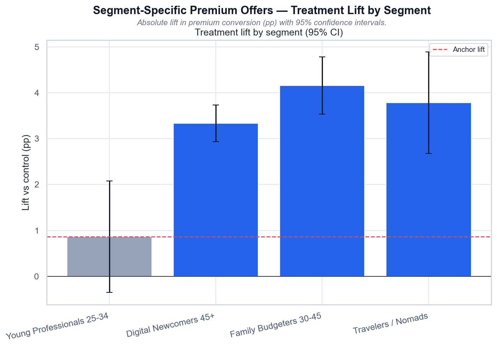

# Volta — Segment Premium Offers

[](https://github.com/NikitaBoyarkin/case-premium-offers/actions/workflows/ci.yml)

[](LICENSE)

A/B: a segment offer lifts gap segments (+3.3pp 45+, +4.2pp families, +3.8pp travelers) — Holm-significant, but the anchor barely moves.

## Key results

- +3.33pp 45+, +4.16pp families, +3.79pp travelers
- All gap lifts Holm-significant
- Anchor +0.86pp — the gap is not closed

## Situation

Project 15 showed the generic upsell doesn't transfer and recommended segment offers — but that was untested. This project tests generic (control) vs segment (treatment).

## Task

The preceding project recommended segment offers but left them untested, so I owned the head-to-head test of the generic upsell against the segment offer.

## Actions

- Randomized A/B, sample-size/SRM checks.
- z-test by segment with 95% CIs, Holm correction.
- Segment × arm interaction (DiD), residual-gap analysis.

## Result

- Treatment lifts gap segments: **45+ 1.6%→5.0%**, **families 4.4%→8.6%**, **travelers 8.8%→12.6%** — all Holm-significant.
- The anchor barely moves (**+0.86pp**): it's already served by the generic offer.
- Residual gap: 45+ treatment (5.0%) is still **~3.8×** below the anchor's generic offer (18.6%).

## Recommendations

- Ship segment offers — a positive, significant ROI.
- Plan for a persistent gap; don't expect parity with the anchor.
- For 45+, combine with the trust track, not the offer alone.

## Charts


> # Segment-Specific Premium Offers — Conversion by Segment × Arm
>
> 
>
> *Конверсия в Premium: generic-апселл (control) vs сегментный оффер (treatment).*
>
> ## Выводы
>
> - Сегментные офферы поднимают конверсию в 3/3 gap-сегментах, но treatment не дотягивает до якоря.
> - Якорь: lift +0.9 п.п. (p=0.16) — в пределах шума; его уже обслуживает generic-оффер.
> - Остаточный разрыв: 45+ treatment (5.0%) всё ещё в 3.8 раза ниже control якоря (18.6%).
> - Вывод: фикс работает, но закрывает разрыв лишь частично.
>
> ---
> <sub>Источник: `scripts/volta_premium_offers.py` · данные: `data/volta_premium_offers.csv`</sub>



> # Segment-Specific Premium Offers — Treatment Lift by Segment
>
> 
>
> *Абсолютный lift конверсии (п.п.) с 95% доверительными интервалами.*
>
> ## Выводы
>
> - Gap-сегменты дают lift в 3.9–4.8 раз больше якоря (якорь: +0.86 п.п.) — сегментный оффер работает именно там, где generic провалился.
> - После Holm-коррекции значимы 3/3 gap-lift.
> - Якорь: lift +0.86 п.п. (p=0.16) — в пределах шума; generic-оффер ему достаточен.
> - Сегментный оффер — не «серебряная пуля»: он сужает разрыв, но не убирает его.
>
> ---
> <sub>Источник: `scripts/volta_premium_offers.py` · данные: `data/volta_premium_offers.csv`</sub>

## Dataset

The dataset is fully synthetic, generated by seeded, reproducible script(s) (`scripts/generate_premium_offers_data.py`). No real customer data is used. Running `make data` regenerates the CSV(s) in `data/` with the same random seed, so every number below is reproducible.

## Quick start

```bash
uv sync --all-groups
make data
make run
```

## Project structure

```text
case-premium-offers/
├── README.md
├── LICENSE
├── .gitignore
├── .python-version
├── pyproject.toml
├── Makefile
├── .github/workflows/ci.yml
├── scripts/
│   ├── generate_premium_offers_data.py
│   └── volta_premium_offers.py
├── utils/
│   ├── __init__.py
│   ├── common.py
│   └── viz_helpers.py
├── data/
│   └── volta_premium_offers.csv
├── outputs/
│   ├── premium_offers_conversion_by_segment_arm.png
│   ├── premium_offers_lift_by_segment.png
└── tests/
    └── test_premium_offers.py
```

## Stack

- Python
- pandas / NumPy
- SciPy / Statsmodels
- scikit-learn
- Matplotlib / Seaborn
- uv + ruff

## Links

- [Full case study on the portfolio site](https://nikitaboyarkin.github.io/en/projects/volta/premium-offers/)
- [Parent project — volta-banking](https://github.com/NikitaBoyarkin/volta-banking)
